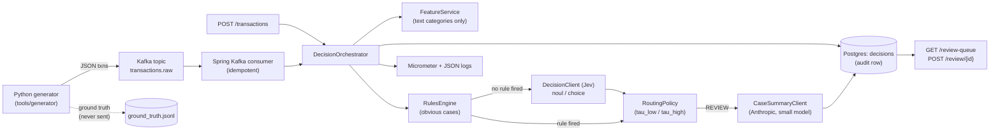

# fraud-flag

A streaming payment-fraud triage service, built as a learning project pairing a 2nd-year CS
student with Claude. A Python generator fakes card transactions (with injected fraud patterns)
onto Kafka; a Spring Boot consumer computes behavioral features in code, runs hard rules first,
falls back to a decision client ("Jev") for the ambiguous cases, and routes each transaction to
auto-approve, hold, or a human review queue -- with an LLM-written case summary for the uncertain
ones and a Postgres audit row for every single decision.

Full phase-by-phase build plan and progress log: [`CLAUDE.md`](CLAUDE.md). New-to-Java/Spring
notes picked up along the way: [`docs/java-notes.md`](docs/java-notes.md).

## Architecture



## Results (real runs, not projections)

All numbers below came from an actual local run of the stack (`docker compose up`, the generator,
and `scripts/score.py`) -- see `CLAUDE.md`'s Progress log for exactly which run each came from.

| Metric | Value | How it was measured |
|---|---|---|
| Consumer lag at demo rate | 0 across all 3 partitions | `kafka-consumer-groups.sh --describe` after a 100-txn generator run |
| Decision rows per transaction | exactly 1 (verified, no duplicates) | Postgres count check after an 80-txn run, plus a Kafka redelivery/dedupe test |
| Precision | 76.09% | `scripts/score.py` against a 120-txn run (35 TP, 11 FP) |
| Recall | 77.78% | same run (35 TP, 10 FN) |
| Auto-resolve rate | 99.17% | same run (119/120 resolved without human review) |
| Escalation rate | 0.83% | same run (1/120 sent to `REVIEW`) |
| Decision latency | sub-millisecond for rule/Jev-only decisions; ~2.5s when a `REVIEW` case triggers a live Anthropic call | `/actuator/metrics/fraudflag.decision.latency` |

**LLM cost per 1k transactions** isn't filled in -- the project doesn't log token usage per call
yet, and at a ~1% escalation rate in this run it would take a much longer run to get a stable
estimate. Known limitation, not a fabricated number.

## Running locally

```bash
cp .env.example .env   # fill in ANTHROPIC_API_KEY if you want real case summaries;
                        # blank keeps MockCaseSummaryClient (free, no API calls)
docker compose up -d --build
./gradlew build         # tests use Testcontainers + an embedded Kafka broker, not this stack

# generate traffic
cd tools/generator
python3 -m venv .venv && source .venv/bin/activate && pip install -r requirements.txt
python generator.py --rate 5 --count 200

# score it
cd ../../scripts
python3 -m venv .venv && source .venv/bin/activate && pip install -r requirements.txt
python score.py --db-password <your POSTGRES_PASSWORD from .env>
```

Review queue: `curl localhost:8080/review-queue`, then
`curl -X POST localhost:8080/review/<id> -d '{"verdict":"APPROVED"}' -H 'Content-Type: application/json'`.

## Deploying to AWS / tearing down

See [`docs/deploy.md`](docs/deploy.md) -- a single EC2 instance running the same
`docker-compose.yml`, with an override for shipping logs to CloudWatch. Every billable command is
written for you to run yourself; nothing in this repo creates AWS resources automatically.

## Known limitations

- `DecisionClient`'s real implementation doesn't exist -- `MockDecisionClient` is active because
  no documented request/response shape for Jev's real `noul`/`choice` API exists yet (a key for a
  service called TypeSafe is in `.env`, but without docs it's not wired in, per the project's own
  "don't invent SDK calls" rule).
- Single EC2 instance, no redundancy; Kafka/Postgres data don't survive instance termination.
- No LLM cost tracking yet (see Results above).
- The generator and the service share the same Kafka topic and schema by convention, not by a
  shared schema registry -- fine for a 3-week MVP, a real system would want one.
